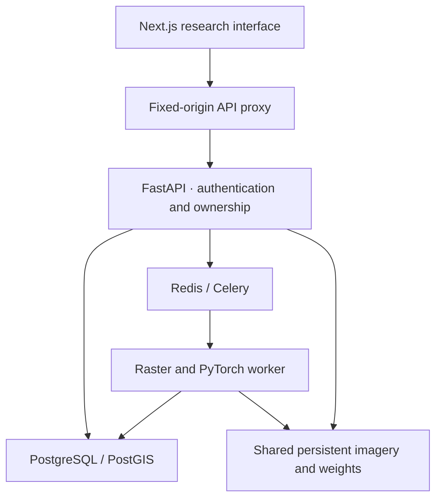

# Architecture and data flow

The research stack and the existing hosted Sentinel workspace have separate identity and storage boundaries. Research accounts use PostgreSQL sessions. The original workspace uses trusted Sites identity and D1/R2. Signing into ChatGPT alone does not manufacture a research account.

## Record ownership

Users own images, AOIs, analyses, training-run history and export audit records. Every protected read checks ownership; private IDs are not sufficient for access. `sessions` contains SHA-256 token hashes; passwords use Argon2. Password resets expire, lock the record for single use and revoke existing sessions. Mutations require a custom protection header and an allowed origin. Redis-backed rate limits fail closed when Redis is unavailable.

Database tables: `users`, `sessions`, `password_resets`, `projects`, `satellite_images`, `areas_of_interest`, `models`, `analyses`, `processing_jobs`, `cloud_masks`, `reconstructions`, `metrics`, `exports`, `model_runs`, `audit_logs`. `projects` is reserved storage; the current UI groups records by account rather than implementing project membership/sharing. Geographic footprints and AOIs have PostGIS geometry columns and spatial indexes in the migration.

The catalog contains model definitions, not dummy results. Operator registration publishes a model checkpoint globally to the research service; measured run history stays attached to its registering account. No browser endpoint accepts arbitrary model code or a pickle checkpoint.

## Processing contract

1. Stream and size-limit the uploaded GeoTIFF. Inspect its actual dimensions, bands, type, CRS, geographic bounds, scales/offsets and checksum.
2. Validate image ownership, reference radiometry, auxiliary mappings and model availability before dispatch.
3. Optionally reproject/crop, then extract Green/Red/NIR into the processing grid. Invalid pixels remain masked.
4. Detect brightness clouds and nearby dark shadows with tile halos, or use the uploaded class mask and its selected band. Store counts and approximate geodesic area.
5. Run overlapping 256/512-pixel patches. Neural inputs use scene 2–98 percentile normalization; temporal/SAR inputs align to the output grid. Blend patch predictions with a positive Hann window.
6. Restore every valid clear pixel from the processing-grid observation. Feathering applies inside reconstructed areas only. Reject nonfinite estimates and clip/round integer output to its representable range.
7. Write georeferenced products and COG reconstruction, compute NDVI using band scales/offsets, evaluate an eligible reference and render previews using a shared optical stretch.
8. Store actual stages, measured runtime, model/checkpoint version, input hashes and complete parameters. Expose owner-only artifacts and reports.

The whole original file may be larger than the output AOI. Clear-pixel preservation applies to the chosen output grid; requesting resampling changes observations to that grid before reconstruction. Warped georeferencing is not automatic subpixel image registration or radiometric harmonization.

## API surfaces

| Surface | Operations |
|---|---|
| `/auth/signup`, `/auth/login`, `/auth/logout` | Research session creation and revocation |
| `/auth/me`, `/auth/forgot`, `/auth/reset` | Profile and reset flow |
| `/images`, `/images/{id}` | Upload and metadata inventory |
| `/images/{id}/preview` | Bounded real raster preview |
| `/analyses`, `/analyses/{id}` | Queue, list, stages and results |
| `/analyses/{id}/preview/{kind}` | Private image comparison products |
| `/analyses/{id}/tiles/{kind}/{z}/{x}/{y}.png` | Real projected result tiles |
| `/analyses/{id}/pixel` | Native values at a geographic coordinate |
| `/analyses/{id}/exports/{kind}` | Raster, metadata and printable report downloads |
| `/aoi`, `/dashboard`, `/models`, `/experiments` | Stored AOIs, actual aggregates, registry and training history |
| `/geography/places`, `/geography/scenes` | Photon places and Planetary Computer scene metadata |

The research STAC browser searches metadata; it does not silently download a Sentinel scene or claim to acquire LISS-IV imagery. Upload properly licensed LISS-IV files manually. FastAPI's `/docs` is generated from the executable schema.
